# Fabricação Digital e Impressão 3D / Digital Manufacturing & 3D Printing

> **Suggested GitHub Repository Description / Descrição Sugerida para o Repositório:**
> **EN:** Presentation slides and documentation covering Digital Manufacturing and 3D Printing concepts, historical timeline, industrial applications, and pros & cons.
> **PT-BR:** Slides de apresentação e documentação abordando conceitos de Fabricação Digital e Impressão 3D, linha do tempo histórica, aplicações industriais e prós e contras.

---

## Language Selection / Seleção de Idioma
- [English Version](#english-version)
- [Versão em Português](#versão-em-português)

---

<a name="english-version"></a>
# Digital Manufacturing & 3D Printing

## 📌 About the Project

This repository contains a comprehensive presentation on **Digital Manufacturing and 3D Printing**, highlighting how physical objects are created from digital CAD/CAM models, the evolution of rapid prototyping, and its transformative impact across various industries.

### 👥 Authors
- Davi Santos
- Lucas Veríssimo
- Matheus Emanuel
- Yago Maia

### 🧠 Topics Covered

1. **Digital Manufacturing (Fabricação Digital)**
   - Definition and usage of CAD (Computer-Aided Design) and CAM (Computer-Aided Manufacturing).
   - Three key pillars:
     - **Life Cycle:** Managing the entire product lifecycle from design to end of life.
     - **Smart Factory:** Integrating machines, sensors, and real-time monitoring tools.
     - **Value Chain:** Optimizing resources, maintaining quality, and minimizing waste.

2. **Historical Evolution (1950s - 2020s)**
   - **1950s-1960s:** Early component development for automotive and aeronautical industries.
   - **1970s:** Introduction of CAD/CAM systems.
   - **1980s:** Emergence of rapid prototyping and Stereolithography (SLA).
   - **1990s:** Advancement and broader adoption of prototyping technologies.
   - **2000s:** Expansion of 3D printing, rise of the maker movement, and founding of FabLabs.
   - **2010s-2020s:** Widespread availability of desktop 3D printers and adoption in end-part production.

3. **Industrial Applications & Examples**
   - **Automotive:** Prototyping and custom parts (e.g., BMW, Ford).
   - **Healthcare & Medicine:** Custom prosthetics, bone implants, and bioprinting (e.g., Stratasys, 3D Systems).
   - **Aviation:** Lightweight structural parts and internal brackets (e.g., Boeing, Airbus).
   - **Fashion:** Custom clothing, footwear, and innovative wearable accessories.
   - **Civil Construction:** Rapid, low-cost 3D printed housing projects.

4. **Pros and Cons**
   - **Pros:** High customization, rapid prototyping, waste reduction, design complexity, cost efficiency for small series.
   - **Cons:** Speed limitations, high equipment cost, material restrictions, technical skill requirements, IP and regulatory concerns.

---

## 🛠️ How to Open and View the Presentation

1. **View Online on GitHub:**
   - Scroll down to the **Slide Demonstration** section below to view screenshots of all slides directly in your browser.

2. **Open the PDF File Locally:**
   - Clone or download this repository:
     ```bash
     git clone https://github.com/lucasverissimo159/impressao_3d_presentation.git
     cd impressao_3d_presentation
     ```
   - Open `impressao_3d.pdf` using any PDF viewer (e.g., Adobe Acrobat, SumatraPDF, Evince, or directly in web browsers like Google Chrome, Mozilla Firefox, or Microsoft Edge).

---

## 🖼️ Slide Demonstration (Screenshots)

<div align="center">

### Slide 1: Cover
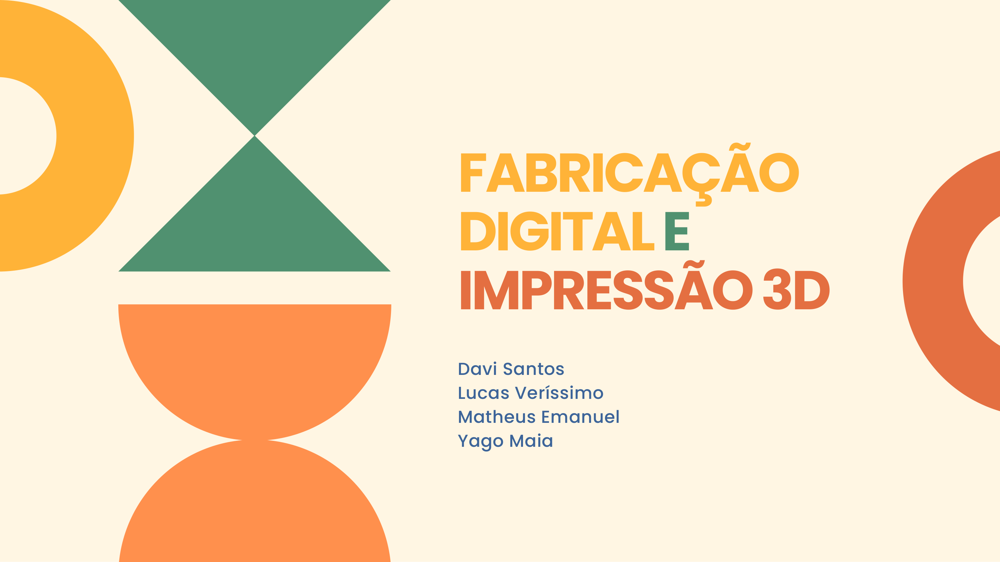

### Slide 2: Table of Contents
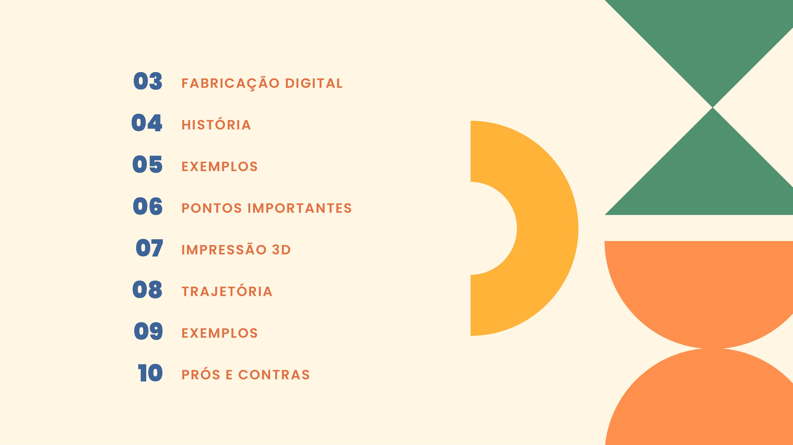

### Slide 3: Digital Manufacturing Overview
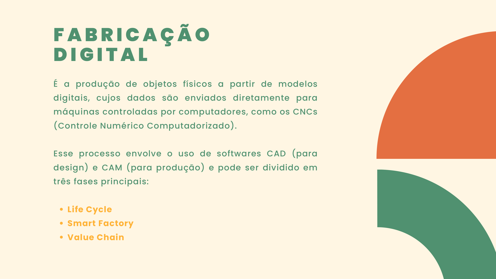

### Slide 4: Pillars of Digital Manufacturing
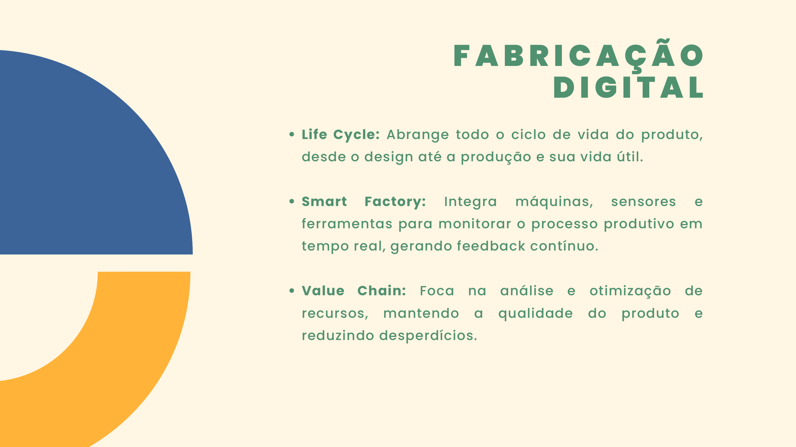

### Slide 5: Historical Evolution
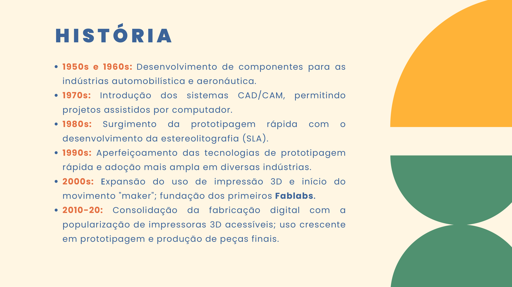

### Slide 6: Automotive Industry
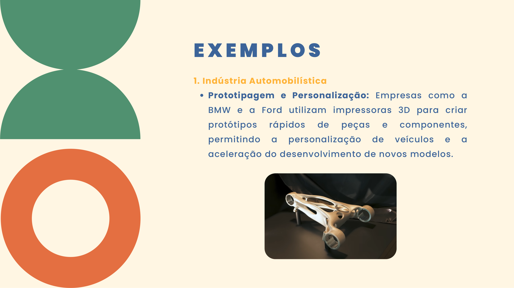

### Slide 7: Automotive Industry (Continuation)


### Slide 8: Healthcare & Medicine
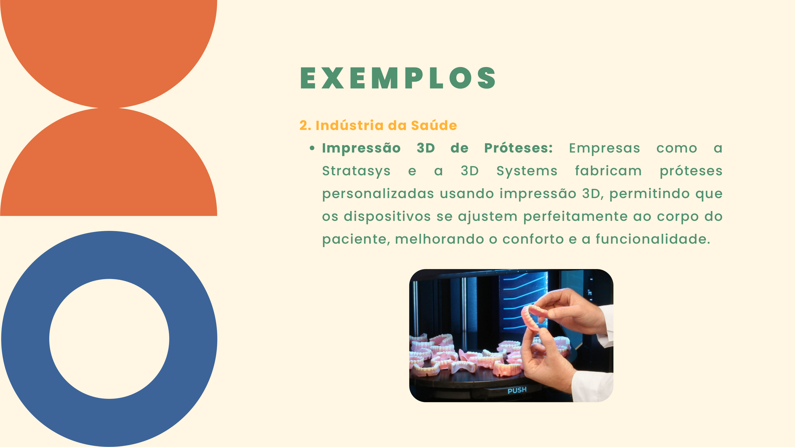

### Slide 9: Healthcare & Medicine (Continuation)
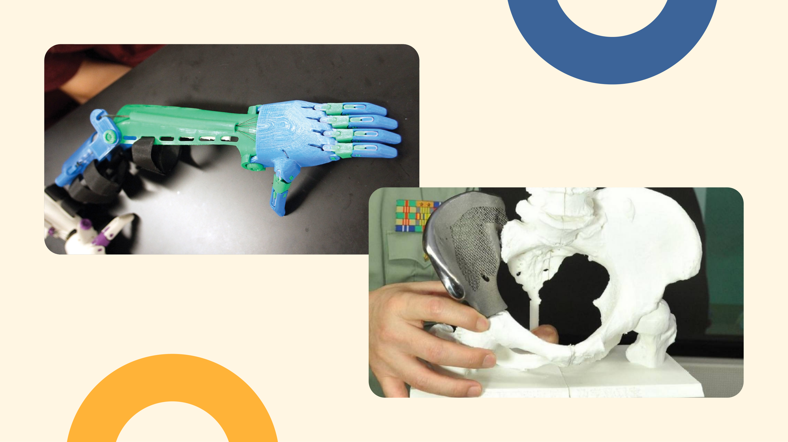

### Slide 10: Aviation Industry
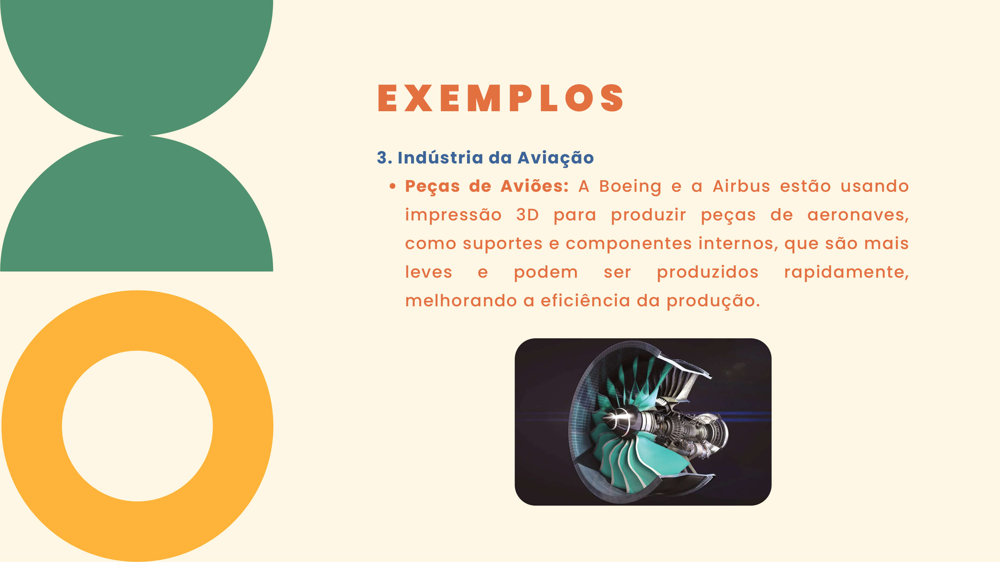

### Slide 11: Aviation Industry (Continuation)
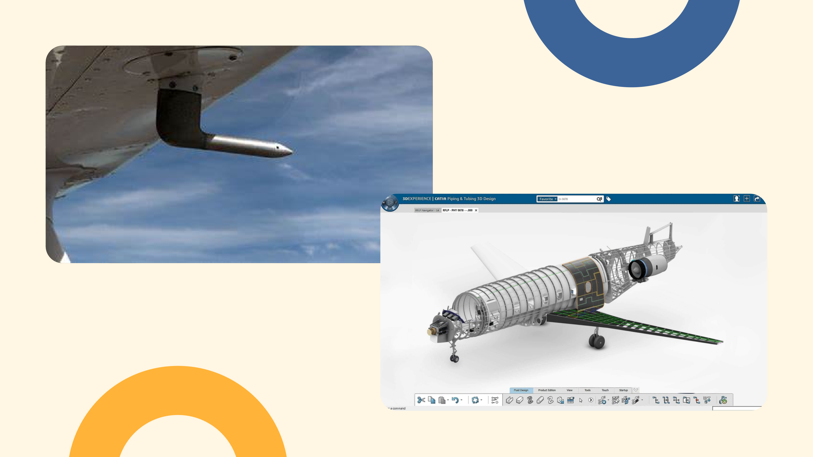

### Slide 12: Key Points & Comparison
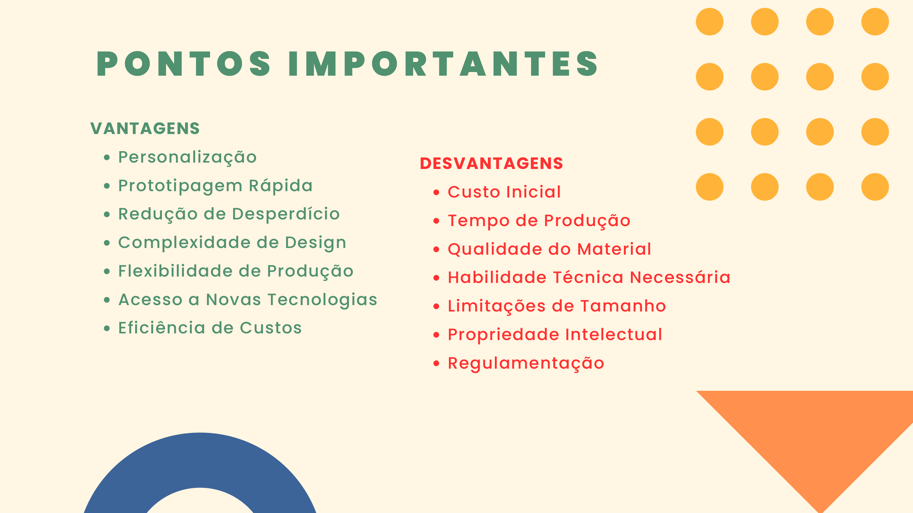

### Slide 13: Medicine, Fashion & Construction
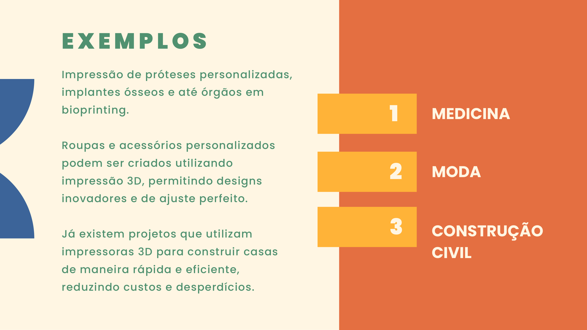

### Slide 14: Applications (Continuation)
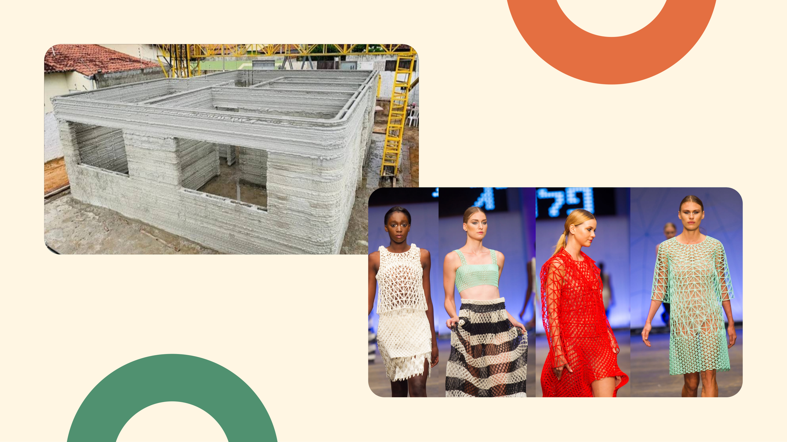

### Slide 15: Pros & Cons
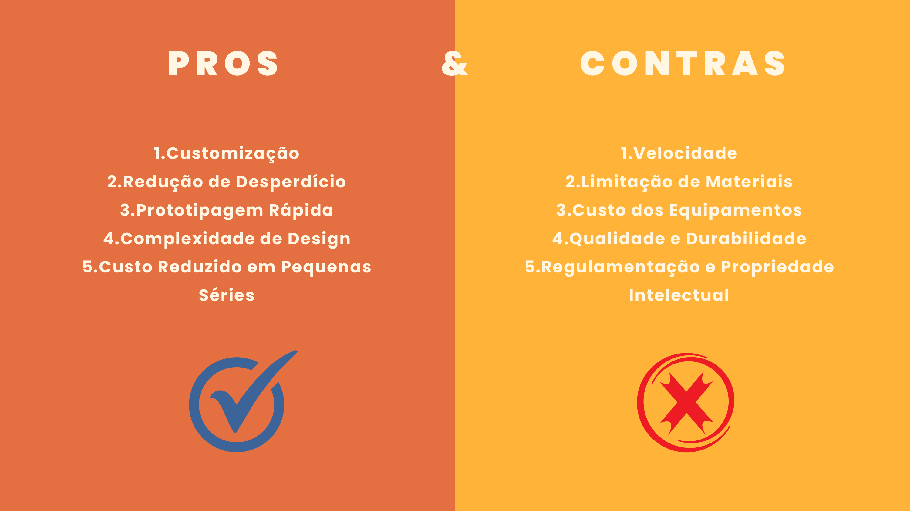

### Slide 16: Annex
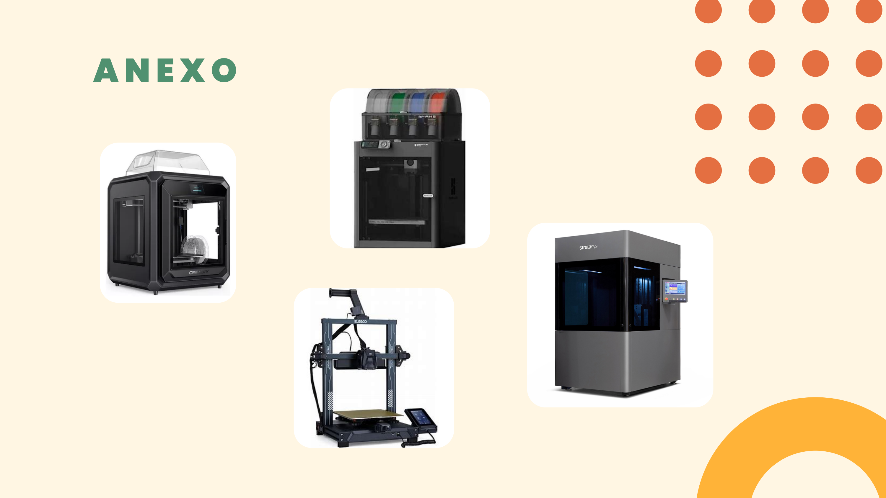

### Slide 17: Thank You


</div>

---

<a name="versão-em-português"></a>
# Fabricação Digital e Impressão 3D

## 📌 Sobre o Projeto

Este repositório contém uma apresentação completa sobre **Fabricação Digital e Impressão 3D**, destacando como objetos físicos são produzidos a partir de modelos digitais CAD/CAM, a evolução histórica da prototipagem rápida e suas aplicações transformadoras em diversos setores industriais.

### 👥 Autores
- Davi Santos
- Lucas Veríssimo
- Matheus Emanuel
- Yago Maia

### 🧠 Tópicos Abordados

1. **Fabricação Digital**
   - Conceito e utilização de softwares CAD (design) e CAM (produção).
   - Três pilares fundamentais:
     - **Life Cycle (Ciclo de Vida):** Gestão do produto desde a concepção até o descarte.
     - **Smart Factory (Fábrica Inteligente):** Integração de máquinas, sensores e monitoramento em tempo real.
     - **Value Chain (Cadeia de Valor):** Análise e otimização de recursos para reduzir desperdícios.

2. **Trajetória Histórica (Anos 1950 - 2020)**
   - **1950s-1960s:** Desenvolvimento inicial de componentes automobilísticos e aeronáuticos.
   - **1970s:** Introdução dos sistemas CAD/CAM.
   - **1980s:** Surgimento da prototipagem rápida e estereolitografia (SLA).
   - **1990s:** Aperfeiçoamento e adoção das tecnologias nas indústrias.
   - **2000s:** Expansão da impressão 3D, movimento maker e criação dos primeiros Fablabs.
   - **2010s-2020s:** Popularização das impressoras 3D acessíveis e produção de peças finais.

3. **Exemplos de Aplicações Industriais**
   - **Indústria Automobilística:** Prototipagem e personalização de veículos (ex: BMW, Ford).
   - **Saúde e Medicina:** Próteses personalizadas, implantes ósseos e bioimpressão (ex: Stratasys, 3D Systems).
   - **Aviação:** Peças e componentes estruturais leves (ex: Boeing, Airbus).
   - **Moda:** Roupas, calçados e acessórios personalizados.
   - **Construção Civil:** Projetos de construção de casas rápidas e eficientes.

4. **Prós e Contras**
   - **Prós:** Personalização/customização, redução de desperdício, prototipagem rápida, complexidade de design e menor custo em pequenas séries.
   - **Contras:** Velocidade de impressão, limitações de materiais, custo inicial de equipamentos, exigência de habilidade técnica e questões regulatórias/propriedade intelectual.

---

## 🛠️ Como Abrir e Visualizar a Apresentação

1. **Visualizar Diretamente no GitHub:**
   - Role a página até a seção **Demonstração dos Slides** abaixo para visualizar todas as páginas em formato de imagem.

2. **Abrir o Arquivo PDF Localmente:**
   - Clone ou baixe este repositório:
     ```bash
     git clone https://github.com/lucasverissimo159/impressao_3d_presentation.git
     cd impressao_3d_presentation
     ```
   - Abra o arquivo `impressao_3d.pdf` com qualquer leitor de PDF (como Adobe Acrobat, SumatraPDF, Evince, ou diretamente no seu navegador como Google Chrome, Firefox ou Microsoft Edge).

---

## 🖼️ Demonstração dos Slides (Capturas de Tela)

<div align="center">

### Slide 1: Capa


### Slide 2: Sumário


### Slide 3: Conceito de Fabricação Digital


### Slide 4: Pilares da Fabricação Digital


### Slide 5: Evolução Histórica


### Slide 6: Indústria Automobilística


### Slide 7: Indústria Automobilística (Continuação)


### Slide 8: Indústria da Saúde


### Slide 9: Indústria da Saúde (Continuação)


### Slide 10: Indústria da Aviação


### Slide 11: Indústria da Aviação (Continuação)


### Slide 12: Pontos Importantes


### Slide 13: Medicina, Moda e Construção Civil


### Slide 14: Aplicações (Continuação)


### Slide 15: Prós e Contras


### Slide 16: Anexo


### Slide 17: Encerramento


</div>
